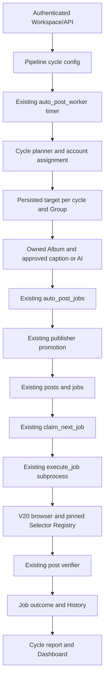

# Multi-account / multi-group publishing: audit and implementation

Candidate branch: `feature/multi-account-cycles`, based on V20 PR #1 commit
`c4d4296ce72f170c7c4d5182fd8e007ad0749306`. This document describes candidate
source, not a production deployment or proof of publication on Facebook.

## Audit before implementation

The existing application already had multiple Facebook profiles, Group URLs,
`group_accounts`, gallery media, three allocation paths, durable execution jobs,
profile locks and the V20 evidence-based browser/verifier. It did not have one
persisted recurring cycle with one assignment per destination. The older shared
and CTV configuration paths could both be called through APIs. Gallery media was
not a catalog of selectable named Albums. History was execution-oriented, without
a cycle report or durable list of excluded disabled destinations.

Source checklist used to estimate the starting point (equal weights, not a
percentage of Facebook reliability):

| Contract | V20 baseline | Candidate source |
| --- | --- | --- |
| Pipeline/CTV tenant guards | Present | Reused; checked on config/claim/execute |
| Multiple independent Facebook profiles | Present | Reused |
| UID uniqueness enforced across imports/concurrency | Partial | Identity reservation + unique index |
| Numeric/slug/Unicode/encoded/redirect Group links | Present | Reused; verified redirect persistence |
| Global disabled state separate from account access | Missing | Global evidence table + pair states |
| Fresh session/membership evidence for assignment | Partial | Fresh, scoped pair eligibility |
| Shared Pipeline configuration | Present | One common cycle configuration |
| Balanced random eligible-account selection | Missing | Persisted weighted-load assignment |
| Persisted account/Group/media assignment | Present | Reused Auto Job, linked cycle target |
| Persistent recurring cycles | Missing | Existing timer calls cycle planner |
| Disabled destination exclusion/skip/continuation | Missing | Plan exclusion + claim/execute guard |
| Admin quota/cooldown policy | Present | Reused; includes plans and Reels |
| Named Albums and rotation/exhaustion | Missing | Pipeline Album catalog + reservations |
| Approved template catalog | Missing | Templates + explicit approval |
| Group/Pipeline AI context and approved fallback | Partial | Existing provider + frozen caption snapshot |
| Registry/composer/identity/caption/one-image preflight | Present | Reused; adds UID and image hash guards |
| One Submit; ambiguous outcome blocks resubmission | Present | Reused; blocks destination across accounts |
| Evidence-based verifier and verified permalink | Present in V20 | Reused without weakening |
| Per-cycle, per-Group actual reports | Missing | Persisted joins and evidence-aware counts |
| Authenticated responsive UI for common cycles | Missing | Four feature views; isolated browser E2E |

Nine of twenty starting contracts were already present: approximately **45% of
this source checklist**. All twenty now have candidate code paths; acceptance and
external Facebook verification are separate gates. Do not call this 100% of a live
production integration. Production does not gain these changes from a Git branch.

## Reuse and boundaries

| Module | Decision |
| --- | --- |
| `app.py` worker/timer/claim/execute | Keep the existing processes; add adapter calls only |
| `services/auto_posting.py`, `services/ctv_auto_post.py` | Keep legacy clients/configuration and caption/media contracts |
| `services/post_scheduler.py`, `scheduler/job_allocator.py`, `scheduler/ctv_allocator.py` | Keep legacy behavior until a cycle config exists; then refuse parallel allocation, including when paused |
| `services/group_screening.py`, `services/group_eligibility.py` | Reuse observations and old APIs; add global disabled guard; new planning uses strict pair evidence |
| `fb_browser.py`, selectors, posting mode, upload, post verifier | Keep the V20 publishing workflow and pinned registry; validate assigned UID and image hash |
| `services/auto_posting_cycles/` | Own cycle persistence, clock, assignment, content, constraints, runtime adapter and reports |
| `api/auto_cycles.py`, `schemas/auto_cycles.py` | Authenticated configuration, library, checks, status and report contracts |
| `frontend/.../auto-posting/cycles/` | Common configuration, Groups/permissions, Albums/templates, schedules/reports |

There is no second autonomous scheduler, worker daemon, or browser implementation.
The legacy `app.py` remains large; this change adds integration hooks rather than
moving unrelated endpoints. New modules stay below 300 lines. A separate app
extraction is not part of this release.

Actual entry points: `prepare_auto_post_jobs → engine.tick → schedule_due →
plan_cycle → assignment.choose → prepare_one → content.generate`;
`publish_auto_post_jobs → runtime.promote`;
`claim_next_job → runtime.claim`;
`execute_job → runtime.before_execute → fb_browser.py post →
wait_post_outcome → validated_result_state → runtime.reconcile`.

## Persistence and behavior

V21 adds seven tables: `workspace_albums`, `workspace_album_media`,
`caption_templates`, `auto_cycle_configs`, `auto_cycles`, `auto_cycle_targets`,
`group_global_status`. Composite foreign keys enforce the Pipeline boundary.
Cycle key uniqueness and `(cycle_id, group_id)` uniqueness prevent duplicate plans.
The target records account, image, final caption/source/context, execution links,
failure level, reason, schedule and preparation lease. Disabled Groups are stored
as a report snapshot without creating posting jobs in later cycles.

The planner chooses only enabled, recently verified connected accounts and known
joined/account-Group links with fresh access, composer and requested identity
evidence. It randomly selects among the lowest load/quota ratios. It does not
divide fifty Groups into fixed five-Group account batches. Ten eligible accounts
can share fifty assignments; if only two are eligible, those two may receive more
than five each when effective limits permit. Lost sessions block their own work;
they never cause an ambiguous submitted job to be reassigned.

The timer creates at most one overdue cycle per Pipeline per pass, advances the
persistent due time and never replays all missed days. Day/window/timezone logic
supports overnight windows. Invalid/paused Pipeline configuration does not roll
back another Pipeline's planning. Manual requests are durable and idempotent even
when session/Group evidence later prevents execution. `NO_ELIGIBLE_ACCOUNT` is a
per-destination result, not deletion of the cycle request.

`refresh.enqueue_due` warms evidence after 22 hours using the existing Group
screening queue, bounded to twenty enqueue operations per timer pass. It checks
only known joined pairs on accounts last verified connected, excludes disabled
Groups/checkpoint accounts and never Joins or Submits. A private browser result
carries a fingerprint rather than raw UID; `record_probe` refreshes connected only
when that fingerprint matches the account. After downtime, a pending cycle with
no healthy destinations can wait at most thirty minutes for queued probes; healthy
destinations are not delayed. Interrupted read-only probes have bounded recovery.
Post-result refresh preserves anonymous/nickname evidence and the timestamp of
the actual Group check instead of manufacturing a new verification time.

Quotas include existing executions, outstanding reservations, preparing targets
and Reels. Account and Group cooldowns are rechecked when claiming. SQL claims and
the existing OS profile lock prevent concurrent use of an account. Preparation
uses a bounded lease and persists the caption before promotion. Interrupted
executions become NEEDS_REVIEW on restart and reconcile back into Auto Job history;
they are never automatically resubmitted.

Global Group status and per-account status are separate. One account's NOT_JOINED,
RESTRICTED or ACCESS_ERROR never sets global DISABLED. Admin can confirm DISABLED
with reviewed evidence. Account checks do not clear it. Reactivation requires a
newer successful Facebook access/publishing check and explicit Admin confirmation;
changing to UNKNOWN cannot bypass the disabled latch. A disabled destination queued
before the change is SKIPPED_GROUP_DISABLED while other destinations continue.

Media stays private and Pipeline-scoped. Selection accepts only eligible images
or explicitly reviewed NEEDS_REVIEW media; CHECK_FAILED/BLOCKED cannot be selected.
No review flags are changed. Named Albums reference existing library media. An
empty selected Album does not fall back to another Album. Repeat off exhausts the
image pool; repeat on permits one approved image in different Groups. Identical
caption+image in the same Group is refused. AI errors only use an explicitly
selected approved fallback. Unique-caption mode refuses reuse rather than silently
rewriting or substituting unapproved content.

## Reports and failure boundaries

Reports join the exact Pipeline, account, Group and Post of the execution.
POSTED requires verifier status `verified` and a post permalink for the correct
Group. Group URLs, avatars and successful clicks do not prove publication.
PENDING_APPROVAL and SUBMITTED_UNVERIFIED stay distinct. Uncertain/pending targets
block further publication to that Group across accounts. Reports include private
thumbnail/evidence links, final caption, job/Post IDs and actual state. Planning
counts are explicitly an upper bound; content generation and final preflight can
reduce them. No metrics or successful outcomes are invented.

| Failure level | Handling |
| --- | --- |
| Group | Disabled skip / no eligible account / destination has open work; continue others |
| Account | Session, profile busy, identity or quota failure; other accounts continue |
| Job | Media/caption/verification failure; no blind Submit retry |
| Pipeline | Paused/conflicting CTV/media exhausted; no cross-Pipeline fallback |
| System | Transaction fails or provider unavailable; preserve queue and report failure |

## Scope limits

No external repository source was copied for this extension. Existing provenance
and redistribution caveats in `NOTICE.md` still apply, especially historical Wahu
similarities. No licensing rights are inferred from a reference.

This task changes neither production data nor live account sessions. No browser
is opened on a production profile. Local fixture permalinks and screenshots are
not Facebook publication evidence. Production deployment, migrations, authenticated
production UI, live AI/provider checks and an individually approved Facebook test
remain separate release gates.
